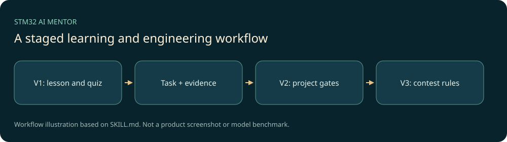

# STM32 AI Mentor

用真实小项目组织STM32学习：课前补齐必要理论与准备度，课中按里程碑动手，课后用解释、排错和迁移证据判断掌握。另有用户明确请求后才进入的完整工程与竞赛工作流，分别保存独立状态。



**开发中的本机定制Skill公开源码。** 本仓库包含教学规则、学习/工程/竞赛状态CLI、课程数据与窄权限执行服务源，不包含真实学生档案、相邻硬件工程、SDK或当前电脑的受管服务配置。

## 快速开始

准备支持项目Skill的宿主与Python3.12+。学习/状态CLI使用标准库：

```powershell
python tools/prepare_workspace.py
python .agents/skills/stm32-ai-mentor/scripts/state_tool.py --profile-dir Student_Profile status
python .agents/skills/stm32-ai-mentor/scripts/state_tool.py --profile-dir Student_Profile validate
```

初始化是源码默认的演示画像（历史名Kevin、F103入门路线），不是原学习者档案，也不是你已拥有特定实物的证据。正式课堂先核对学习目标、器件丝印、供电与已有基础，未知信息保留未知。`Student_Profile/`、`Projects/`和`Competitions/`应始终留在自己的本地工作区，禁止提交真实状态。

在项目中让宿主加载`.agents/skills/stm32-ai-mentor/SKILL.md`，例如：

```text
使用 $stm32-ai-mentor 学习STM32。先给我一个适合当前基础的生活小任务，说明必要理论；我还没有提供硬件实物，不要假定引脚和接线已经确认。
```

工程和竞赛侧车账本分别由两个CLI管理，可先查看帮助，不会因此启动工程或竞赛：

```powershell
python .agents/skills/stm32-ai-mentor/scripts/project_tool.py --help
python .agents/skills/stm32-ai-mentor/scripts/competition_tool.py --help
```

已有实际项目时才按`Projects/<project_id>`或`Competitions/<competition_id>`读取状态，不将两者合并到学习账本。

## 能力与依赖

- V1课堂默认：准备度4/5、安全门、分级提示、作业与证据账本。
- V2完整项目：需求、硬件护照、方案、生成与量化验收，由明确工程请求触发。
- V3竞赛：先核对当届官方规则，再组织前案、创新证据、工程和报告，不自动报名/提交。
- `stm32-lab-mcp`与`eda-lab-mcp`源提供权限和产物边界；可选依赖为MCP SDK、pyserial及相应官方工程工具。历史EDA后端是KiCad，Flux仅为可选研究接口；这不代表已连接到你的电脑或嘉立创EDA。

本机或新机器的执行服务必须显式审阅安装器、在仓库外创建自己的工具锁和权限策略，源码下载不会注册或自动启动MCP。真实板卡烧录仍需每次单次确认。**构建成功不等于功能通过**，Mock也不能证明实板。此公开归档没有启动EDA/Bridge、扫描真实设备或烧录。

## 结构与检查

```text
.agents/skills/stm32-ai-mentor/ 完整111文件核心、教案、目录与Python服务源
tests/                         既有确定性测试、合成硬件数据及HAL烟测源
examples/codex/                只读角色配置示例，不自动启用
docs/research/                 原来源、许可、路线与机制研究
tools/prepare_workspace.py     新建演示状态与可选测试脚手架
```

在新下载副本中安装测试依赖并准备测试脚手架：

```powershell
python -m venv .venv
./.venv/Scripts/python -m pip install -r requirements-dev.txt
./.venv/Scripts/python tools/prepare_workspace.py --test-config
./.venv/Scripts/python tests/run_all.py
```

已有`.codex`配置会被拒绝覆盖。角色中的模型名与工具版本为历史源定义，不说明当前宿主可用。可选Cube固件编译测试需要独立安装、接受原许可并准备固定官方SDK；本仓库不分发SDK，缺失时明确跳过。

本次实际软件检查与未验证项见[VALIDATION.md](VALIDATION.md)。温湿度站等教案是工作流与代码示例，实物功能需在相应项目中分别验收。原有PHYLLO、active-inspection等硬件工程另仓归档，未混进本Skill。

## 来源、许可与后续

本机AI辅助定制项目，原开发与许可证记录声明所有教案、HAL用法片段、测试和状态脚本自主编写，未复制ST完整例程或第三方课程；[原许可登记](docs/research/03-license-register.md)保留引用边界。自有部分按[MIT](LICENSE)公开，外部工具/SDK/资料各自适用原协议。

后续按真实课堂和授权硬件证据完善迁移体验；不把个人学习历史或当前受管配置上传。[PROVENANCE.md](PROVENANCE.md)与[CHANGELOG.md](CHANGELOG.md)记录此次范围。
